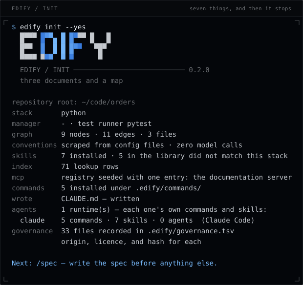
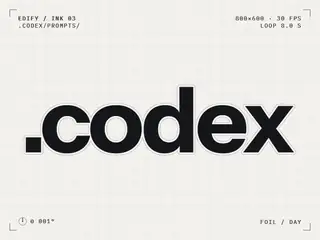
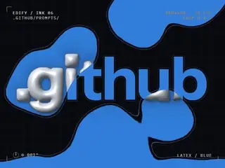
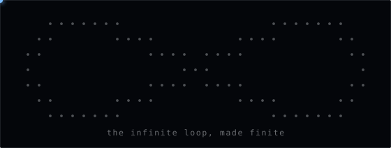

<div align="center">


# EDIFY

**Three documents and a map. Think hard once, then build without thinking.**

[Install](#install) · [The four commands](#the-four-commands) · [The graph](#the-graph) · [Docs](docs/) · [Website](https://edify-agents.github.io/EDIFY/)

</div>

EDIFY is a harness that sits around an AI coding agent and makes it work reliably on
large, real codebases — a million lines, fifteen years of history, four languages. It
is not a model, not an agent framework, and not a wrapper around a chat interface: a
stdlib-only CLI, `edify`, plus four short commands your agent runs.

A frontier model with a plain setup writes excellent code and still fails on serious
projects, from four structural gaps no model generation closes. EDIFY closes exactly
those four and gets out of the way of everything else:

- **It cannot see a codebase it cannot fit in context** → a mechanically extracted
  graph, queried instead of re-derived every session.
- **It fragments across sessions** → a spec, a plan and a task list that every session
  and every swarm member builds against.
- **It builds what was asked instead of what was meant** → `/spec` marks unknowns
  `[NEEDS CLARIFICATION]` and ends at a human.
- **It writes against the library it remembers, not the one installed** → a pinned,
  per-role MCP server registry.

## Install

macOS, Linux and Windows, from one artifact. Python 3.10+ is the whole requirement — no
dependencies, no compiler, no runtime. The package is
[`edify-agents-cli` on PyPI](https://pypi.org/project/edify-agents-cli/).

```bash
pip install edify-agents-cli            # or: pipx install / uv tool install edify-agents-cli
brew install edify-dev/tap/edify        # macOS, if you prefer brew

cd your-repository
edify init                              # detect, extract the graph, install, write CLAUDE.md

edify init new ./service                # or: a folder from zero, for every agent
```

<p align="center">
  
</p>

`init` detects the stack, extracts the graph, scrapes conventions from your config
files, installs the skill entries your stack matches, seeds the server registry, writes
a fifteen-line `CLAUDE.md`, and records every file it put there. It asks one question —
which library entries to install, since they become trusted instruction — and with no
terminal (CI, a pipe, a model) it asks nothing.



```bash
edify init --yes                        # the whole matched set, no question
edify init --skills planner,verifier    # exactly these
edify setup ./service --yes             # a new folder, root pinned there
edify setup . --fresh --yes             # reinstall the harness over this repository
```

`edify init new` installs for every agent runtime at once, after eight skippable
questions whose answers go to `.edify/profile.md`:

| runtime | reads | commands land in |
|---|---|---|
| Claude Code | `CLAUDE.md` | `.claude/commands/`, `.claude/skills/`, `.claude/agents/` |
| OpenAI Codex | `AGENTS.md` | `.codex/prompts/` |
| Cursor | `AGENTS.md`, `.cursor/rules/edify.mdc` | `.cursor/commands/` |
| Gemini CLI | `GEMINI.md` | `.gemini/commands/` (TOML) |
| GitHub Copilot | `.github/copilot-instructions.md` | `.github/prompts/` |
| Windsurf | `.windsurf/rules/edify.md` | `.windsurf/workflows/` |

<table>
  <tr>
    <td></td>
    <td></td>
    <td></td>
  </tr>
  <tr>
    <td></td>
    <td></td>
    <td></td>
  </tr>
</table>

Per-platform detail, PATH fixes, updating, and uninstalling: [INSTALL.md](INSTALL.md).
It runs offline: only `edify upgrade` and `edify self update` open a socket.

## The four commands

| command | what it does | ends at |
|---|---|---|
| `/spec` | a brief becomes a specification; unknowns marked `[NEEDS CLARIFICATION]` | a human |
| `/plan` | binding decisions, milestones, a partition for parallel work — only when needed | a human |
| `/tasks` | spec + plan + graph → leaseable tasks, **then builds them**: one agent or a swarm | a green suite |
| `/verify` | evidence on every surface — service, browser, device, live API — from a fresh session that wrote no code | a report anyone can read |

The build is the same loop at any scale:

```bash
edify swarm claim            # lease the next ready task nobody's work overlaps
edify swarm prompt T-7       # skill + task + decisions + graph slice + scoped servers
# … build it, run its done-check, commit on swarm/T-7 …
edify swarm done T-7         # the next claim may now unblock
```

One agent runs it in a loop; a swarm runs it in N worktrees at once; people on
different machines add `--git`, and the remote's `edify-swarm` branch becomes the lock.
Leases are phase-gated and overlap-safe: a task whose files, or their dependents, touch
a live lease waits.

<table>
  <tr>
    <td width="50%"></td>
    <td width="50%"></td>
  </tr>
  <tr>
    <td align="center"><sub><code>/spec</code> · <code>/plan</code> · <code>/tasks</code> — three reads, one after another</sub></td>
    <td align="center"><sub>the <code>/tasks</code> run — red to green</sub></td>
  </tr>
</table>

The command files live once in `.edify/commands/`, with thin pointers under each
runtime's command directory. Skills are mirrored the same way (`.claude/skills/<name>/SKILL.md`
points at `.edify/skills/<name>.md`); `edify skills sync` rewrites the mirror.
Verification comes first: phase 2 of every build turns each spec assertion into a
failing test before any core logic exists, so a cheap builder is hitting a target, not
judging its own work.

## The graph

<p align="center">
  
</p>

Every file, module, exported symbol, route and table, with the edges between them, as
sorted checksummed text — a rebuild over unchanged source is byte-identical. **It is
never written by a model**: an uncovered language has no nodes and
`meta.languages_uncovered` says so. Python is parsed with a real syntax tree; the rest
by a line scanner, or by Universal Ctags with `--extractor ctags`.

```bash
edify graph build                     # full extraction
edify graph where isExpired           # → src/auth/clock.ts:12  symbol  isExpired
edify graph dependents createSession  # everything that breaks if it changes
edify graph overlap "a.ts b.ts" "c.ts"# can these two tasks run at once
```

**Built for repositories no context window holds.** No agent reads a million-line
graph, so the graph summarises itself:

| command | answers |
|---|---|
| `edify graph map` | `MAP.md`: subsystems, hubs, and the bridges parallel work collides on |
| `edify graph context "<task>"` | the slice one task needs — files with line ranges, one hop of edges — under a token budget |
| `edify graph explain <x>` · `path <a> <b>` | every edge of one node, or how two connect |
| `edify graph update --changed` · `hook` | re-extract only what git says changed; git hooks keep it current |

Exit codes: 0 answered, 3 ambiguous (pin with `file::name`), 4 not found. Every other
command — `check`, `skills`, `mcp`, `governance`, `doctor`, `license`, `feedback`,
`self` — is in the [CLI reference](docs/cli.md).

## What lands in your repository

```
CLAUDE.md, AGENTS.md, …  # ~15 lines each: what this repo is, the commands, the graph
.edify/
  graph/                 # nodes.tsv, edges.tsv, MAP.md — mechanical, regenerable
  skills/                # the subset your stack matched, plus index.tsv
  commands/              # the four command files
  formats/               # the three format contracts and their worked examples
  mcp.md                 # the server registry: pinned, scoped per role and phase
  conventions.md         # scraped from lint/format/tsconfig/CI — no model call
  governance.tsv         # every file above: origin, provenance, licence, hash
specs/<feature>/         # spec.md · plan.md · tasks.md · verification.md
```

`edify governance verify` reports any installed file that changed since it landed.
Nothing blocks: `edify check` prints, and `--exit-code` is how you turn it into a gate
you own.

## Editions, privacy, and what EDIFY does not do

<p align="center">
  
</p>

**The public edition is the whole product**: MIT-licensed, free, no account, any
repository size, with no caps — the full MCP registry included. The team edition,
`edify-agents-teams`, is by licence; a licence is a signed token verified locally,
issued on request. `edify license status` says which edition
this machine runs.

**There is no telemetry** — not anonymous, not aggregate, not opt-out. `edify feedback`
writes four answers to a file on your machine and prints how to send it, if you choose.

EDIFY does not wrap the agent runtime, host a model, run a server or daemon, or enforce
anything at runtime. It makes a competent model efficient; it does not make a weak one
competent. On a small solo project a frontier model in auto mode is already excellent —
the value starts where the codebase stops fitting in the context window.

## Docs and development

[Quickstart](docs/quickstart.md) · [CLI](docs/cli.md) · [Graph](docs/graph.md) ·
[Agents](docs/agents.md) · [Verification](docs/verification.md) ·
[Privacy](docs/privacy.md) · [Troubleshooting](docs/troubleshooting.md) ·
[Changelog](CHANGELOG.md) · [Contributing](CONTRIBUTING.md)

```bash
git clone https://github.com/EDIFY-agents/EDIFY && cd EDIFY
pip install -e ".[dev]"
pytest
```

The suite checks that this repository satisfies what it asks of yours: every skill file
valid and under budget, every command file short, every worked example parsing against
its format.

## Licence

See [LICENSE](LICENSE). Skill files carry their own provenance and licence in
frontmatter; entries marked `provenance: adapted` are governed by their upstream licence.
