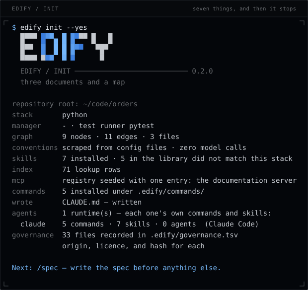
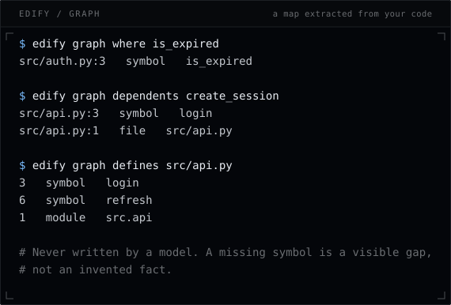
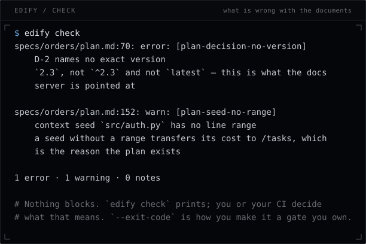
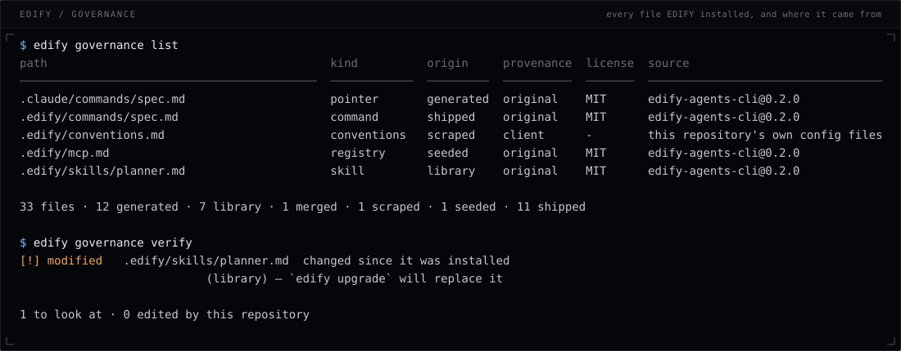
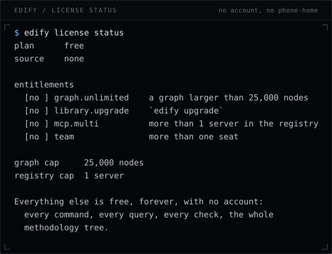

# CLI reference

`edify` installs the harness, builds and queries the graph, resolves skills, and
checks formats. It is a pure function over files: every command reads files and
writes files, and none holds state or opens a socket while doing your work.

Global flags: `--repo PATH` · `--json` · `--no-color` · `--no-anim` · `--quiet` · `--version`

---

## How it looks

At a terminal, `edify` borrows the site's identity: the wordmark with the ink poured
into it as `init` opens, labels set as quiet readouts, hairline rules, and the site's
state marks — `[x]` a pass in blue, `[!]` advisory in amber, `[-]` blocked in oxide,
`[ ]` not covered. The infinity it draws while it works is the same ink, with a
readout of how long the wait has been.

None of that reaches a pipe, a file, CI, or `--json`: there the output is the plain
ASCII it has always been, so a script that reads it keeps working.

| control | effect |
|---|---|
| `--no-color`, `NO_COLOR=1` | no colour anywhere; marks and hairlines fall back to ASCII |
| `--no-anim`, `EDIFY_NO_ANIM=1` | no wordmark, no infinity — the step names still print |
| `EDIFY_THEME=day` | the palette for a light terminal (`night` is the default) |
| `COLORFGBG` | read if set: a light background picks `day` on its own |
| `COLORTERM=truecolor` | exact brand colours; otherwise the nearest of 256, or the basic 16 |
| `EDIFY_AGENT=1` | agent mode: terse output, one-line errors with a hint, no prompts (also on under `CLAUDECODE` / `GEMINI_CLI`; `EDIFY_AGENT=0` turns it off) |
| `EDIFY_JOBS=N` | worker processes for `graph build` on trees of 1,500+ files; `1` forces a serial build (same bytes either way) |

---

## Install

The CLI itself is the [`edify-agents-cli`](https://pypi.org/project/edify-agents-cli/)
package: `pip install edify-agents-cli` (or `pipx install` / `uv tool install`). The
commands below install the harness into a repository.

| command | what it does |
|---|---|
| `edify init` | install the harness into this repository (asks which skills) |
| `edify init --yes` | …the whole matched set, no question |
| `edify init --skills a,b` | …exactly these entries; `none` for none |
| `edify init new PATH` | a folder from zero, for **every** agent runtime — asks first |
| `edify init new . --agents claude,cursor` | only these runtimes |
| `edify setup PATH` | pin the root here, create the folder if missing, install everything |
| `edify setup . --fresh` | clear EDIFY's own files first, leave everything else |

`init` finds its root by walking upward, so a new folder inside an existing
checkout installs into the parent. `setup` pins the root where you point it.

## The graph

| command | what it answers |
|---|---|
| `edify graph build` | full extraction |
| `edify graph build --extractor ctags` | parse-grade precision beyond Python |
| `edify graph where NAME` | where is this — file, line, kind |
| `edify graph dependents NAME` | everything that breaks if it changes |
| `edify graph defines FILE` | what this file exports |
| `edify graph references NAME` | who calls or imports this |
| `edify graph overlap "a.ts b.ts" "c.ts"` | can these two tasks run at once |
| `edify graph stat` | nodes, edges, files, languages, coverage |
| `edify graph map` | `.edify/graph/MAP.md`: subsystems, hubs, and the bridges parallel work collides on |
| `edify graph context "<task>"` | the files and line ranges one task needs, under a token budget |
| `edify graph explain NAME` · `path A B` | every edge of one node, or how two connect |
| `edify graph update --changed` · `hook` | re-extract what git says changed; hooks keep it current |

···  `edify graph where` · `dependents` · `defines`

See [graph.md](graph.md) for what is covered and what is not.

## The build loop

`/tasks` writes the task list and then builds it with these. One agent runs them in a
loop; a swarm runs them in N worktrees at once; people on different machines add
`--git`, and the remote's `edify-swarm` branch becomes the lock.

| command | what it does |
|---|---|
| `edify swarm board` | every task and its state |
| `edify swarm claim` | lease the next ready task whose files overlap no live lease |
| `edify swarm prompt T-7` | the spawn payload: skill, task, decisions, graph slice, scoped servers |
| `edify swarm done T-7` | record the done-check passed and release the lease |
| `edify swarm release` · `renew` · `block` | give back, extend, or block a lease |

## The documents

| command | what it does |
|---|---|
| `edify check` | report what is wrong with the spec, plan, and task list |
| `edify check --fix` | fix what can be fixed mechanically |
| `edify check --exit-code` | non-zero on error — this is how you make a CI gate |
| `edify check --json` | machine-readable findings |

···  `edify check`

**Nothing blocks.** `edify check` prints; a person or a CI job decides what that
means. If you need a hard block, that is `--exit-code` or `/verify` in your own
CI, owned by you.

## Skills and servers

| command | what it does |
|---|---|
| `edify skills list` | the installed library, with role, phase, tech, budget |
| `edify skills resolve implementer 4` | the one file a spawn at that phase loads |
| `edify skills add NAME` | install one entry from the library |
| `edify skills sync` | rewrite the per-runtime mirror after a hand edit |
| `edify mcp list` | the server registry |
| `edify mcp for implementer 4` | what servers that spawn would load |
| `edify mcp config implementer 4` | write only those servers to an MCP config |

## Governance

| command | what it does |
|---|---|
| `edify governance list` | every file EDIFY installed: origin, provenance, licence, hash |
| `edify governance verify` | is it still what was installed |
| `edify governance verify --exit-code` | …as a gate you own |
| `edify governance rebuild` | re-baseline after a deliberate change |

···  `edify governance list` · `verify`

`verify` separates a file EDIFY owns being changed — `upgrade` will overwrite it
— from a file your repository owns being maintained, which is what `.edify/mcp.md`
and `.edify/conventions.md` are for. The graph is deliberately not in the ledger:
it is regenerated output and carries its own checksums.

## Health, licence, feedback

| command | what it does |
|---|---|
| `edify doctor` | does the install work here |
| `edify self where` | which `edify` is this, and where did it come from |
| `edify self update` | replace the binary — hands fetching to uv, pipx, or pip |
| `edify self update --offline` | refuse to touch the network |
| `edify license status` | which edition this machine runs, and what a licence adds |
| `edify license activate TOKEN` | the token you were sent — verified locally |
| `edify feedback` | four questions, written to a file on this machine |
| `edify feedback list` | what you have written; none of it has been sent |
| `edify feedback off` | never show the invitation again |
| `edify upgrade` | pull a newer curated library and re-index |
| `edify upgrade --from ARCHIVE` | …from a local file, for an air-gapped machine |

···  `edify license status`

## The two commands that open a socket

`edify upgrade` and `edify self update`. That is the complete list, it is
[enforced in CI](../.github/workflows/guard.yml), and both have an offline path.
See [privacy.md](privacy.md).
